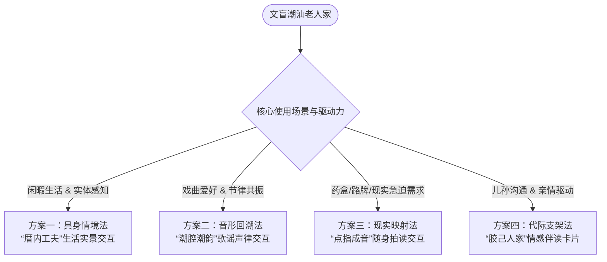
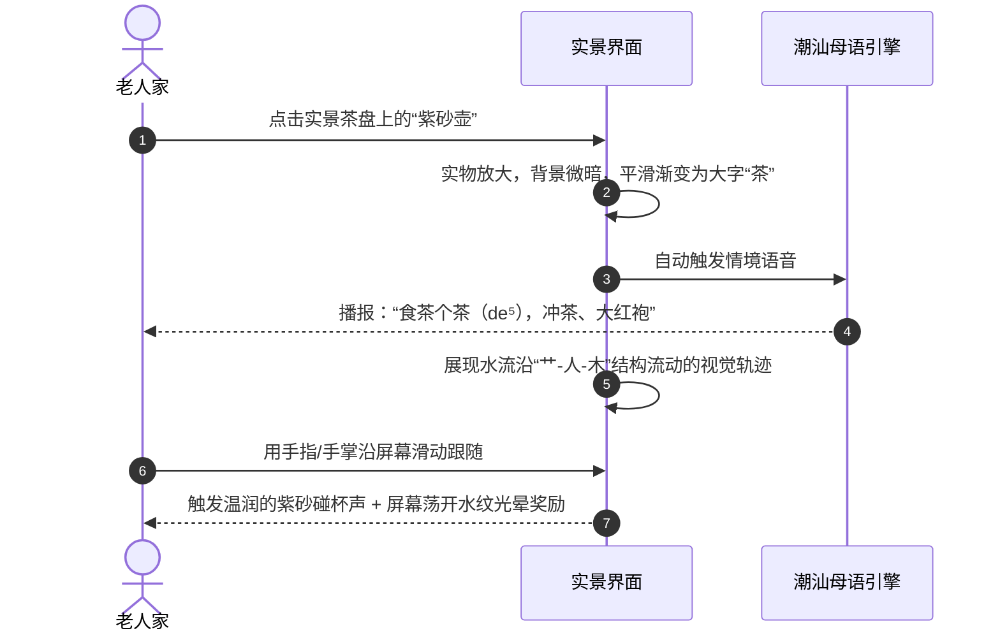
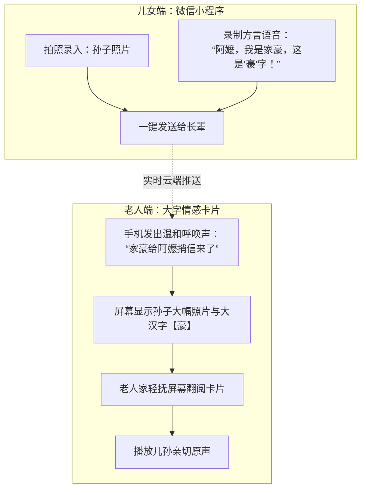
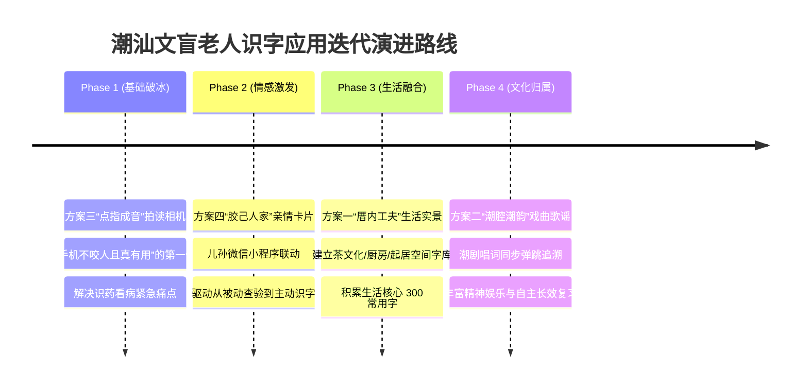

# 潮汕文盲高龄老人识字应用系统交互方案设计规范

---

## 1. 项目背景与目标用户画像

### 1.1 目标群体特征分析
本项目面向**潮汕本土及旅居在外的文盲/极度低识字量高龄老年群体**。这部分用户在生理、认知、语言与心理四个维度具有鲜明的特征：

| 维度 | 现实特征与局限 | 潜在长时记忆与认知优势 |
| :--- | :--- | :--- |
| **语言环境** | • 仅掌握潮汕方言（母语思维），无普通话听说能力<br>• 不懂现代汉语拼音（无法通过字母注音辅助） | • 拥有极度丰富的潮汕口语词汇储备<br>• 对潮汕熟语、歇后语、生活俗谚天然敏感 |
| **生理机能** | • 老花眼、白内障等视力减退，对对比度敏感度降低<br>• 手指干燥、微颤、关节不灵活，精细触控精度极低<br>• 听觉高频衰退（Presbycusis），对尖锐电子提示音不适 | • 大动作运动记忆（扫、拍、握、端）完好<br>• 对低沉亲切的人声保留较好的感知力 |
| **认知结构** | • 工作记忆（Working Memory）容量下降，无法处理复杂菜单层级<br>• 抽象符号解析能力为零（文字、汉堡菜单、齿轮图标毫无意义） | • 生活经验极其丰富，熟悉实体空间（茶桌、厨房、神台、菜市）<br>• 潮剧（潮州戏）、潮州歌谣长时听觉记忆稳固 |
| **心理特征** | • 极强的新技术畏惧感（“按错手机会坏”、“点错要赔钱”）<br>• 文盲带来的自卑感与对麻烦儿女的自责心理 | • 极其重视家庭伦理与宗族情感（爱孙/敬祖）<br>• 对日常自理生活（看药名、识路牌）有强烈的自主渴望 |

---

## 2. 认知科学与学习心理学理论基础

为了打破“以文字为中介”的传统教学逻辑，本系统架构深度融合以下认知科学理论：

### 2.1 双重编码理论 (Dual-Coding Theory - Allan Paivio)
* **核心机制**：人类认知由“非言语表象系统”（视觉/实体图像）与“言语系统”（语音）双轨构成。
* **应用转化**：文盲群体未建立“文字字形（Grapheme）”与“语义（Semantics）”的直接联结，但拥有强烈的“生活实物（Image）”与“潮汕语音（Phoneme）”的对应通道。系统将汉字作为媒介置于实物与潮音之间，促成“实物图像 ⇆ 潮语发音 ⇆ 汉字形态”的三向共振。

### 2.2 具身认知理论 (Embodied Cognition)
* **核心机制**：思维与认知植根于身体与物理环境的互动，运动感觉经验直接参与概念的表征与理解。
* **应用转化**：摒弃精细化的笔顺拆解评分，将汉字笔画映射为大动作具身运动（如冲工夫茶的“水流轨迹”、抹桌子的手势），使字形通过肌肉运动记忆自然沉淀。

### 2.3 听觉节律线索与记忆提取 (Rhythmic Auditory Cueing)
* **核心机制**：大脑听觉皮层与运动/记忆皮层的节律性同步能够显著降低认知检索阻抗。
* **应用转化**：借助老人长时记忆深处的潮剧板眼唱腔（一板一眼、二板等节拍）与传统歌谣韵脚，通过韵律引导视线聚焦汉字变色，实现“因声辨形”。

### 2.4 无错误学习与脚手架理论 (Errorless Learning & Scaffolding)
* **核心机制**：老年神经认知在遭遇挫败（如“回答错误”、“警告红叉”）时极易产生习得性无助与逃避行为。
* **应用转化**：系统内严禁出现任何“负向反馈”；点击非目标区域时，系统仅以柔性光晕与自然语言提示温和引导，确保每一次交互均产出正向成就感。

---

## 3. 四大系统交互方案设计



---

### 方案一：【具身情境法】“厝内工夫”生活实景交互方案

#### 1. 认知设计理念
以潮汕老人的典型物理生活空间为拟物映射（Skeuomorphism），消除一切数字化 UI 界面痕迹（无按钮、无状态栏、无菜单），进入即是“生活”。

#### 2. 交互情境映射
* **场景一：工夫茶桌**（核心词：茶、水、壶、杯、火、汤、甘）
* **场景二：厝内药箱**（核心词：药、日、早、晚、丸、温）
* **场景三：拜老爷神台**（核心词：香、果、吉、利、平安、拜）

#### 3. 核心交互链路


#### 4. 特色交互细节
* **物字渐变形态（Morphing）**：不突兀弹窗，通过 1.2 秒的慢速动画让实物轮廓平滑变为汉字笔画，直观展示象形起源。
* **物理手势容错**：只要手部在大致范围内滑动，水流便自动吸附并点亮笔画，零挫败感。

---

### 方案二：【音形回溯法】“潮腔潮韵”节律共振交互方案

#### 1. 认知设计理念
文盲老人虽不识字，但其听觉记忆中的戏曲与歌谣词句完好无损。通过将已存储的“音-意”反向映射到“形”，降低工作记忆负荷。

#### 2. 交互架构与视觉呈现
* **视觉主界面**：采用横屏全屏展示，单屏仅显示 3~5 个超大汉字（字高占屏幕高度的 50%）。
* **卡拉OK式节拍弹球**：由传统潮乐“铜钟”或“金桔”造型的光球伴随潮剧唱腔逐字跳跃。

```
+--------------------------------------------------------+
|                                                        |
|        天    顶    一    只    鹅                      |
|              ▲                                         |
|           (金桔光球)                                    |
|                                                        |
|   ♪ [潮乐伴奏] tiⁿ¹  deng²  zeg⁸  gho⁵ ♪               |
|                                                        |
|   [老人轻触任意位置即可暂停并详解]                     |
+--------------------------------------------------------+
```

#### 3. 核心交互机制
1. **触屏即定格（随心选字）**：老人家在欢快听唱过程中，随时轻触屏幕任何区域，乐声柔和暂停。
2. **聚光灯语义解析**：手指触碰选中的汉字独立居中高亮，其余字淡出，地道潮音响亮解析：
   * *“这字读【鹅】（gho⁵），天顶飞过一只大鹅。”*
3. **低负荷跟读反馈**：系统麦克风智能监测老人的方言跟读。老年人声带衰老、发音含混，算法采用宽裕置信度阈值，只要有声音呼应即判定成功，并以木鱼清脆敲击声作为听觉正强化。

---

### 方案三：【现实映射法】“点指成音”随身拍读辅助方案

#### 1. 认知设计理念
针对高龄老人实际生活中的“生存痛点”（识药、辨路、看告示），提供即时情境学习（Just-in-Time Learning），将焦虑转化为成就感。

#### 2. 交互流程设计


#### 3. 关键交互突破
* **全自动取景（零按钮操作）**：
  * 老人拿稳手机对准物体 1.5 秒后，系统通过光流检测判定静止，自动触发 OCR 文字锁定，无需老人寻找并点击“拍照快门”。
* **双通道方言释义**：
  * 单纯念出字音对文盲老人帮助有限。例如识别到感冒药盒上的“**服**”字，系统播报：
  * *“阿伯，这个字念【服】（hog⁸），就是‘食药’的意思，包装上写每次食两粒。”*
* **“随身字簿”记忆温存**：
  * 自动将老人拍过的药盒、路牌归档为带生活实景背景的识字卡，便于闲暇时反复滑动复习。

---

### 方案四：【代际支架法】“胶己人家”情感伴读卡片方案

#### 1. 认知设计理念
引入社会认知理论中的代际情感脚手架。对于潮汕老人而言，辨认“孙辈名字”、“儿女电话备注”、“老家门牌”是其最强烈的自主认字动机。

#### 2. 双端架构模型


#### 3. 交互细部考量
* **隐喻设计**：卡片样式采用潮汕传统的“侨批（潮汕跨国信件）”或“宗族大相册”设计，符合老人的时代记忆审美。
* **物理手势响应**：仅支持单指或手掌“翻页”（左右滑、上下拂过皆可响应），不支持任何复杂缩放或多指手势。

---

## 4. 适老认知工效学与底层设计规范

### 4.1 视觉感知通道规范
1. **字符层级与骨架**：
   * 汉字主字号：最小基准 **56pt**（全屏单字时可达 **120pt~180pt**）。
   * **字体严选楷体（KaiTi/仿宋正楷）**：严禁使用超细几何无衬线黑体。正楷保留汉字笔画起笔、运笔、顿笔骨架，与实物象形记忆高度吻合。
2. **色彩感知与对比度**：
   * 严格满足 WCAG AAA 级对比度要求（文本与背景对比度不低于 **7:1**）。
   * 采用高对比但柔和的护眼配色：**玄青底（#1A1A1A）+ 暖金文字（#FFD700）**，或**熟宣纸色（#F4EEDD）+ 浓墨文字（#181818）**。
   * 绝对避免在深红底上放置绿色，规避高龄老人常见的红绿辨识衰退。

### 4.2 潮汕方言声学规范
1. **文白异读策略**：
   * 潮汕话具有极为严格的“文白异读”（文读书面音，白读口语音）。识字应用**一律优先采用白读口语音**：
     * 如“**肉**”字，念白读 `[neg⁸]`（如同“食肉”），绝不念文读 `[iog⁸]`。
     * 如“**学**”字，念白读 `[oh⁸]`（如同“学乖”），绝不念文读 `[hag⁸]`。
2. **8个声调的精准保真**：
   * 潮汕话拥有独特的8个声调与极为复杂的连读变调（Tone Sandhi）。
   * 单字发音必须播报**本调**，词组播报必须保证**自然连读变调**，严禁使用拼凑字音的机械音节拼接。
3. **音频频段补偿**：
   * 老年性耳背对高频听阈提高显著。系统音频滤波剔除 4000Hz 以上尖锐声音，增强 300Hz~2500Hz 饱满中低频。
   * 播报语速默认设定为普通语速的 **0.75倍 ~ 0.8倍**，字间停顿增加 300ms。

### 4.3 触控运动与容错规范
1. **超大可触控面积**：
   * 核心互动热区尺寸不小于 **80 × 80 dp**（远超普通 App 的 48 × 48 dp 规范）。
2. **防颤与长按触发**：
   * 针对帕金森或生理性手颤老人的频繁抖动，引入 **200ms 防抖去颤时间窗（Touch Debounce Window）**。
   * 重要确认动作引入“轻长按 0.5 秒”或“按压即播”，避免轻点误触带来的不知所措。
3. **无错误正向交互原则（Errorless Interaction）**：
   * 系统全局**不设置任何红叉、警告弹窗、错误蜂鸣**。
   * 老人误点其他区域时，界面仅对真正可点击区域触发波纹微光提示，并伴随温和方言指引：*“阿伯，摸这里试一下”*。

---

## 5. 系统实施与落地路径规划



### 5.1 试点与用户测试建议
1. **在地化方言测试**：潮汕地区内部涵盖“汕头话”、“潮州话”、“揭阳话”、“海陆丰话”，在声调和部分词汇存在细微差异。首批测试样本应选取典型三市交界村居，提供子方言自适应选择。
2. **测试评估指标**：
   * **任务完成信心度**（观察老人操作时是否出现缩手、频繁看身边儿女等焦虑动作）；
   * **字形提取成功率**（脱离应用后，在生活实物包装上能否准确指出该字）；
   * **主动打开频次**（是否转化为日常查药、听歌的伴随工具）。
